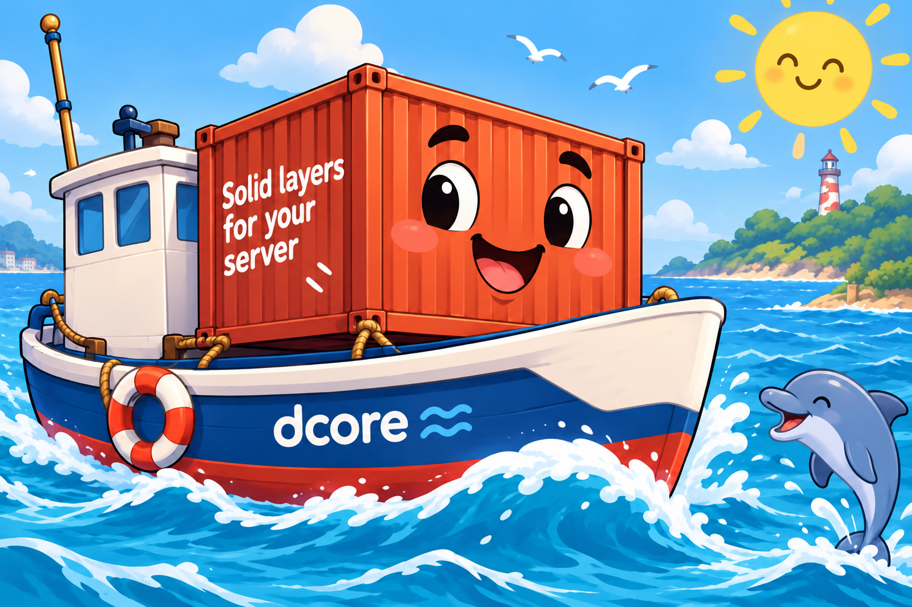

# dcore



dcore brings immutability into the Debian ecosystem. It is built from the
[official Debian Docker image](https://hub.docker.com/_/debian) and prepares
Debian Trixie as an immutable bootc operating system for hosting virtual machines
and containers.

**This is still Debian, prepared for server use.** The project focuses on
packaging and configuring Debian in an immutable form. Its Debian packages come
from Debian repositories and use [Debian's security update infrastructure](https://www.debian.org/security/),
with updates delivered through rebuilt system images and bootc upgrades.

Another goal is seamless integration of the latest stable Incus into the
immutable system image. Incus comes from Zabbly's stable repository and is
updated alongside the operating system through image builds and upgrades.

The image-based operating model is inspired by Universal Blue's
[uCore](https://github.com/ublue-os/ucore). The build implementation starts from
[bootcrew/mono](https://github.com/bootcrew/mono/blob/main/debian/Containerfile);
see [UPSTREAM.md](UPSTREAM.md) for attribution.

**dcore is still a work in progress and is not running anywhere in our production yet.**

**Signed releases support UEFI Secure Boot.** The offline ISO uses Debian's
signed shim, GRUB and kernel. Installed dcore uses Debian's signed shim,
systemd-boot and kernel; its build-time ZFS modules are signed with the dcore
key. Firmware must trust Microsoft's third-party UEFI CA, as for Debian.
Use the installer's **Enroll key** button or `djust enroll-secureboot`, then
reboot and confirm the certificate in MokManager before using ZFS. The public
certificate is included in the image, ISO, EFI partition and release assets.
See [Debian's Secure Boot documentation](https://wiki.debian.org/SecureBoot).

This authenticates EFI binaries, the kernel and loadable modules. The external
initramfs, boot arguments and composefs root digest are not signed as a sealed
UKI; Secure Boot compatibility does not provide complete root filesystem
attestation.

It includes Debian ZFS (with a module compiled for the image kernel), Incus from
[Zabbly's stable repository](https://github.com/zabbly/incus), Docker and Compose,
and the requested CLI tools. Run backup tools such as Restic and Rustic in
Docker or Podman containers.
Podman supplies bootc's required container runtime; sudo is included for administration.
Release downloads are checked against upstream SHA-256 checksums.
`bat` and `ripgrep` provide Debian's `batcat` and `rg` commands.

## Features

- Debian Trixie with configurable release variants, daily OCI builds and Debian
  release tags (`trixie`, `stable`, `latest`).
- GitHub release artifacts: offline installer ISO, 10 GiB raw, QEMU QCOW2 and Incus VM images.
- Incus guest agent and installers for Incus VMs and physical block devices.
- ext4 by default, with Btrfs and XFS installer options; automatic root growth
  when the root partition is last and disk space follows it.
- Designed for a single system disk; system-disk RAID is not currently supported.
- Optional passphrase-protected LUKS2 root in `block_install`.
- `core` administrator with passwordless sudo; installation SSH keys shared
  with root. Password-based SSH login is disabled by default; password-provisioned
  installations enable it for core.
- Persistent Homebrew owned by core, with command paths for every user,
  including root, and Distrobox for development containers.
- Open vSwitch, ready for administrator configuration.
- `djust` administration commands for installation, upgrades, Incus, SSH keys and LUKS2/TPM management.
- Weekly automatic image updates and reboot, disabled until enabled by the user.
- Time synchronization and scheduled filesystem trimming enabled by default.

## Installed tools

- Default administrator: `core`, with passwordless sudo and shared installation
  SSH keys for root and core.
- Shell and terminal: fish (root/core default), fastfetch, htop, vim, tmux, iotop, ncdu, duf.
- Networking and APIs: nmap, wget, curl, HTTPie (`http`/`https`),
  iputils-tracepath (`tracepath`), rsync, rclone.
- Development and files: git, jq, unzip, bat (`batcat`), ripgrep (`rg`),
  bzip2, zstd, build-essential.
- Containers: Incus (Zabbly stable), Incus guest-agent integration (Debian), Docker (`docker.io` and `docker-cli`),
  Docker Compose (`docker compose`), Podman, Distrobox, skopeo.
- Package management: Homebrew, owned by the `core` user in persistent storage.
- Switching: Debian Open vSwitch (`openvswitch-switch`,
  `openvswitch-common`).
- System: bootc, OSTree, sudo, OpenSSH server, systemd-networkd, systemd-resolved,
  systemd-timesyncd (enabled), fstrim timer (enabled).
- Storage: SMART diagnostics and monitoring (`smartmontools`, `smartctl`, `smartd`), Debian ZFS (`zfsutils-linux`, `zfs-zed`, `zfs-dracut`, and
  `zfs-dkms` compiled for the image kernel), parted, `btrfs-progs` (`btrfs`), ext4, XFS and FAT utilities, cryptsetup and systemd-cryptsetup.

The full package/version inventory is `/usr/share/dcore/packages.tsv` inside
an image.
## Administration with djust

The image includes Debian's `just` command runner and a system Justfile at
`/usr/share/dcore/justfile`. Run `djust` from any directory to open the command
picker, or `djust --list` to list commands.
Invoke it directly as `core` or another ordinary user; root and `sudo djust` are rejected. Individual system
operations use sudo, while Homebrew runs as its owner, `core`.
Privileged commands request sudo automatically; core has passwordless sudo.
New installations default to hostname `dcore`. Set a different name with
`sudo hostnamectl set-hostname NAME`. Fastfetch appends `(dcore)` to its Debian
OS line through a system-wide default configuration.

| Command | Behavior |
| --- | --- |
| `djust enroll-secureboot` | Request dcore certificate enrollment on this machine; choose a temporary password and confirm in MokManager on reboot. |
| `djust enroll-tpm` | Enroll TPM2 automatic unlocking of the root LUKS2 partition, preserving password recovery. |
| `djust change-luks-password` | Interactively change the root LUKS2 password; TPM enrollment remains intact. |
| `djust upgrade` | Stage the OS update, then run Homebrew update and upgrade as core; reboot separately to apply the OS update. |
| `djust upgrade os` / `djust upgrade homebrew` | Update only the selected component, for example after a failed upgrade. |
| `djust install` | Open the shared installer wizard; choose an unused drive, filesystem, encryption and core password, then install the exact booted image version. |
| `djust install plain` | Use the original SSH public-key prompts for installation. |
| `djust gen-sshkey` | Generate `/var/home/core/.ssh/id_ed25519` as core, or report an existing key without replacing it. |
| `djust enable-autoupgrade` | Choose a weekly day/time in the system's local timezone and explicitly approve automatic upgrades and reboots. |
| `djust enable-incus` | Enable the Incus server and add core to incus-admin, or offer to disable it when already enabled/running. |
| `djust switch-locale` | Search available locales with fzf and apply the selection system-wide; log in again to use it. |
| `djust set-timezone` | Search available timezones with fzf and apply the selection immediately. |
| `djust set-hostname` | Enter and apply a new system hostname; Enter cancels without changes. |
| `djust hush-banner` | Toggle the automatic login banner for the current user; applies on the next login. |

The image includes precompiled Debian locales for use with immutable `/usr`.
`switch-locale` applies your choice with Debian's `update-locale` tool;
Debian's read-only localed policy blocks `localectl set-locale`.
In either picker, type to search, use arrow keys to choose, and press Enter to
apply. Esc cancels without changing the system configuration. Switching locale
sets the system's `LANG`; existing locale category settings and user-specific
preferences can still override it. Existing services may need restarting to use it.

The same Go installer, built with Bubble Tea, is included in both dcore and the offline ISO.
`djust install` runs its interface as the ordinary caller and elevates individual
backend operations through sudo. It excludes the running system's mounted,
swap and mapped disks, shows the selected drive's existing partitions, and asks
for confirmation before erasing it.
It reuses a cached OCI image with the booted digest, or downloads that exact
version, and preserves the image reference for updates on the new installation.
Host staging uses `/var/lib/containers` on the existing host filesystem;
the ISO's 16 GiB RAM requirement applies to live RAM staging. Allow at least
10 GiB free host storage when downloading an uncached image. Retries preserve
completed deployment and credentials stay in memory. Host mode never offers
an automatic reboot of the current server. The wizard's rescue shell runs as
the caller; use sudo there if administration is needed.

The `djust install plain` fallback reuses the block installer's disk identity
and busy-device checks. Only validated public keys or `authorized_keys` from `/root/.ssh` or
`/var/home/core/.ssh` are offered; private keys are never copied. The final
installer requires typing `ERASE` followed by the destination path. An SSH
public key is required for access to the installed server.

SSH key generation asks for an optional passphrase using `ssh-keygen`'s normal
prompt. LUKS password changes and TPM enrollment use the tools' own interactive
password prompts; passwords are not put into command arguments or stored files.

Automatic upgrades remain disabled until approved. The command writes its
schedule under `/etc/systemd/system/dcore-update.timer.d/20-ujust.conf`, clears
the original calendar and random delay, then enables the timer. Missed runs can
trigger an immediate update. A new image is applied with a server reboot; an
unchanged image does not reboot. A root requiring manual LUKS unlock needs
console access after these reboots.

The Incus server, startup service, socket activation and LXCFS are disabled by
default. Enabling Incus starts them; initialize its configuration afterward with
`sudo incus admin init`. Disabling it can stop running instances and requires
confirmation. The Incus **guest agent** remains available independently.

TPM enrollment supports dcore's direct LUKS2 `dcore-root` layout and requires a
TPM2 resource-manager device with a nonzero SHA256 PCR 7 measurement. Enrollment
refuses firmware that leaves this PCR uninitialized. The image includes TPM
libraries, drivers and initramfs support. Boot tries enrolled TPM tokens with password fallback.
Enrollment uses PCR 7, which tracks firmware Secure Boot policy and permits
ordinary kernel/image updates without binding to a particular kernel hash.
PCR 7 does not authenticate the external initramfs, boot arguments or composefs
root digest. Enable Secure Boot and complete certificate enrollment before TPM
enrollment, and retain the existing password for recovery if the TPM or firmware
policy changes. Existing
TPM enrollment is replaced only after approval; password/recovery slots are
preserved. See [systemd's TPM policy documentation](https://www.freedesktop.org/software/systemd/man/systemd-cryptenroll.html).

## Core user, Homebrew and Distrobox

Root and core use Fish as their default login shell. Interactive SSH and local
console logins show Fastfetch with the bundled dcore logo rendered as terminal
character art. The image build uses Chafa to render `logo.png` into a portable
36×12 ANSI logo, so consoles need no image protocol or pixel-size queries.
Running `fastfetch` displays it again. Remote commands and non-login shells do
not display the banner.

To toggle the automatic Fastfetch display for your user on SSH and local console
logins, run:

```sh
djust hush-banner
```

The command creates `~/.hushlogin` to disable the banner, or removes it to enable
the banner again. It needs no sudo and takes effect on your next login. You can
also manage the flag manually with `touch ~/.hushlogin` and `rm ~/.hushlogin`.
Running `fastfetch` manually still works when the banner is disabled.

The image creates `core` with a persistent home at
`/var/home/core` (`/home/core` resolves there too). Its password is locked by
default; use `sudo -iu core` from an administrator account or add an SSH public
key to its home directory. `core` has passwordless sudo for all commands as
the default administrator account. When an installation SSH public key is provided, it is installed for
both root and core. Existing locally managed core keys are preserved on later
boots.
Fresh installations use UID 1000 for core.

Homebrew uses its standard Linux prefix, `/home/linuxbrew/.linuxbrew`, backed by
`/var/home/linuxbrew/.linuxbrew` and owned by `core:core`. The image carries an
upstream bootstrap copy, including portable Ruby. `dcore-homebrew.service`
initializes it locally on the first boot without downloading an installer.
Existing Homebrew installations and formulae are preserved across later boots
and bootc image upgrades. The initial installer/repository commits are recorded
in `/usr/share/dcore/homebrew-seed-versions`; Homebrew updates afterward are
managed by core independently of bootc.

Homebrew's `bin` and `sbin` precede the usual system directories in the global
PATH. PAM login environment, login/su defaults, Bash/POSIX profile setup, Fish,
Debian Zsh, sudo's secure path, and systemd service/user-manager environments
are configured so all users, including root, can find installed commands.
The configuration sets static paths and never evaluates user-managed brew code
during root shell startup. A `/usr/bin/brew` launcher also exposes brew when a
caller deliberately uses a minimal system PATH. Shells inherit their session's
PATH; explicit custom PATH overrides or `--no-config` startup remain under the
caller's control.

Manage packages **as core**; Homebrew's own restrictions on package-management
commands run as root still apply:

```bash
sudo -iu core
brew --version
brew install hello
hello
# Later:
brew update
brew upgrade
```

Root and other users can then run `hello` directly after opening a new session.
For a one-off command from root, use `sudo -u core -H brew install PACKAGE`.
To inspect initialization and ownership:

```bash
systemctl status dcore-homebrew.service
journalctl -b -u dcore-homebrew.service
getent passwd core
stat -c '%U:%G %a %n' /home/linuxbrew/.linuxbrew
command -v brew
```

Distrobox is installed from Debian and uses Podman. Core gets subordinate UID
and GID ranges plus a lingering systemd user manager for rootless containers.
From core's login shell:

```bash
distrobox create --name debian-dev --image docker.io/library/debian:trixie
distrobox enter debian-dev
```

Containers, Homebrew packages and caches consume persistent disk space; grow
beyond the initial 10 GiB disk when using them extensively. These installations
stay in `/var`; `/usr` remains managed by bootc and read-only.

## Open vSwitch

Open vSwitch is installed from Debian. Its switching service is disabled by
default so an administrator can configure it before starting it. Netplan
may start the OVS database service for cleanup even when switching is disabled;
its database and logs live in persistent `/var`. For Open vSwitch:

```bash
sudo systemctl enable --now openvswitch-switch.service
sudo ovs-vsctl show
```

## Build and publish

The [GitHub repository](https://github.com/rosti-cz/dcore) automatically builds
and publishes OCI images from the `main` branch every day at 02:23 UTC. Builds
also run on pushes to `main`, on pull requests, and on manual dispatch.
GitHub releases distribute disk images and the offline installer; daily OCI builds do not
require a release. Successful `main` builds publish the same image to:

- `ghcr.io/rosti-cz/dcore:trixie`
- `ghcr.io/rosti-cz/dcore:stable`
- `ghcr.io/rosti-cz/dcore:latest`

These daily tags describe **Debian releases**, not the maturity of the dcore
project. `trixie` is Debian's codename; `stable` follows the Debian release
selected by `stable_release`; `latest` is an alias for that same default stable
Debian build. None of these tags imply that dcore is production-ready.

The repository's `GITHUB_TOKEN` needs package write access (already requested by
the workflow). Set the GHCR package to public if hosts should pull anonymously;
otherwise configure registry credentials on each host. No publishing is done
for pull requests or manual builds on other branches. CI currently builds amd64;
the Containerfile also supports native arm64 builders.

`build-config.json` selects `releases`, `stable_release`, `bootc_ref`, and
`incus_channel`. Add a future codename to `releases` to build it alongside Trixie;
only `stable_release` receives `stable` and `latest`. Change `stable_release`
when ready to promote the new release. Zabbly must support that codename first,
and Debian package names and kernel/ZFS compatibility need validation.

Local build (Podman/Buildah recommended, no cache to refresh latest releases):

```sh
sudo podman build --pull=always --no-cache --squash --format=oci \
  --build-arg DEBIAN_RELEASE=trixie \
  --build-arg BOOTC_REF=v1.17.1 \
  --build-arg SECUREBOOT_REQUIRED=0 \
  -t dcore:trixie -f Containerfile .
sudo podman run --rm dcore:trixie /usr/libexec/dcore/verify-image
```

The local example is an unsigned development build: its DKMS modules are not
trusted by the dcore certificate. Published builds require
`SECUREBOOT_SIGNING_KEY` in GitHub Actions and pass it only through a Podman
secret mount. An authorized signed local build replaces
`--build-arg SECUREBOOT_REQUIRED=0` with
`--secret id=secureboot_key,src=/protected/path/dcore.key`; the key must match
`secureboot/dcore.crt`. Never pass private keys as build arguments or copy them
into the build context. Pull-request builds never receive the production key.

bootc is pinned to v1.17.1. Trixie's libostree 2025.2 lacks composefs support
and is too old for current bootc. `shared/build-ostree.sh` builds pinned
OSTree 2026.4 and composefs 1.0.8 from checksum-verified upstream release
archives on Trixie, then installs them over the Debian boot-stack binaries.
Their versions and archive checksums should be updated together deliberately.
The image checks that its OSTree binary actually has composefs support.
ZFS and all requested distro tools remain Debian packages.

This creates a bootable OCI image. Use a bootc-compatible
installer/provisioning flow to install it, supply an administrator account and
SSH authorized key, and choose a persistent registry tag as the image source.
Password SSH login is disabled by default; password-provisioned installations
enable it for core. On the first boot, `dcore-network-bootstrap.service` waits
in the background for a connected physical Ethernet port and configures DHCP
on the first port in interface-name order. The configuration matches its
hardware-assigned MAC address, so interface renames do not change the chosen
port. IPv4/IPv6 DHCP, router advertisements and DNS are enabled.

Edit `/etc/systemd/network/10-dcore-dhcp.network` for static addressing or other
custom networking. Any existing entry in `/etc/systemd/network`, including masks
and drop-ins, permanently skips automatic setup. Discovery never blocks startup
and runs only during the first boot; if the machine reboots before a cable is
connected, configure networking manually. Its persistent decision is recorded
in `/var/lib/dcore/network-bootstrap.done`. The installer ISO uses the same
first-connected-port setup. Netplan is no longer included.

## Offline installer ISO

Every GitHub release also builds
`dcore-VERSION-trixie-amd64-installer.iso`, an offline bare-metal installer.
It contains the exact release OCI image and a minimal Debian live environment;
no network connection or registry login is required to install. The accompanying
`-installer-manifest.json` records the source digest and update reference. Both
files are covered by the release's `SHA256SUMS`.

Write the ISO to a USB drive using an image-writing tool, or attach it through
your server's virtual CD/DVD interface. Boot in **UEFI mode**; signed release
ISOs also support Secure Boot. Allow **16 GiB RAM** for the live environment and image staging, and
select a system drive of at least **10 GiB**. Image staging uses RAM and never
uses the destination disk as temporary storage. The installer checks RAM and
free staging capacity before loading the image; the release manifest records
its minimum RAM requirement. Podman temporary image files share the dedicated
RAM filesystem with its image store, instead of filling the live `/var/tmp`
overlay. An approximately 800 MiB VM cannot stage this image.

The Go Bubble Tea interface lists eligible whole drives with size, model and serial.
Use Tab or Up/Down to select fields, Left/Right to change choices, Space to toggle
encryption, and Enter to activate controls.
Review the installation, inspect
logs, retry a failed step, or open a rescue shell.
Select **ext4** (default), **Btrfs**, or **XFS**, then choose an unencrypted root
(default) or **LUKS2 encryption**. All three filesystems support both modes.
Enter the `core` password twice with input hidden; encrypted installations also
ask for a separate disk-unlock passphrase twice. The installer displays the
drive, its existing partitions, filesystem and encryption settings for review.
Confirm **Erase drive and install** to proceed; typing a drive path is not required. It excludes the installer medium, mounted disks, active swap
and storage mappings, and rechecks drive identity after loading the bundled
image. Both modes install through `block_install` without contacting a registry.

LUKS2 protects the root filesystem, `/etc`, `/var`, home directories and container
data. The EFI partition, kernel and initramfs remain unencrypted. Unlock the disk
at the console on **every boot**, including automatic-update reboots; SSH becomes
available after unlocking. The installer does not store an unlock key or enroll
a TPM. After installation, optional TPM unlocking is available through
`djust enroll-tpm`. Complete Secure Boot certificate enrollment first if using it.

After installation, remove/eject the ISO and reboot. Log in at the local console
as `core` with your chosen password; core has passwordless sudo. The same password
also works over SSH as `core`, for example `ssh core@SERVER_IP`. Root and other
accounts retain the default SSH policy. For key-based access, add your public key to
`/var/home/core/.ssh/authorized_keys` with directory mode 0700, file mode 0600,
and ownership `core:core`. No default password or SSH key is baked into the ISO.
The installed system tracks `ghcr.io/rosti-cz/dcore:trixie` for later updates,
while automatic updates remain disabled until enabled by the administrator.

The progress screen tracks image loading, destination checks, OS deployment,
account configuration, verification and cleanup. **Retry step** keeps completed
stages: a failed password setup, verification or cleanup does not erase the OS
again. Failure during OS deployment can leave an incomplete disk and requires a
fresh erase confirmation before reinstalling. Upgrade commands similarly offer
to retry only their failed substep in an interactive terminal.

Checkpoints and logs live in the private `/run/dcore-installer` directory for the
current live boot. Restarting the interface restores progress and asks for the
passwords again; passwords are held in memory and are never saved in checkpoints
or logs. A reboot of the live environment loses these checkpoints. Reboot is
available after all installation stages succeed. **Rescue shell** is available
while no installation operation is running.

The installer serves an embedded web interface on **port 80** while it runs.
Its terminal screen prints reachable IP addresses and a randomly generated
**six-digit PIN**, including leading zeros. Open the displayed URL and enter the
PIN to use the same inputs, erase confirmation, progress, retries and logs.
Both interfaces share one session; concurrent starts are rejected and settings
are locked after deployment. The browser interface works offline. A new process
generates a new PIN; sessions expire after two hours. PIN attempts are rate limited
and authenticated changes require CSRF protection.

**Use HTTP on a trusted management network:** it does not encrypt passwords in
transit. The terminal remains usable if port 80 is occupied. The rescue shell is
local. Secure Boot enrollment accepts a temporary password in either interface;
confirmation still happens in MokManager after reboot. Only the completed live ISO
installation offers reboot; host installation does not reboot the server.

To build an ISO locally, use an amd64 Linux host with root, Podman, gzip and
Python3. The build needs network access for the Debian live environment, even
though the resulting installer operates offline:

```bash
sudo scripts/build-installer-iso.sh \
  ghcr.io/rosti-cz/dcore@sha256:RELEASE_DIGEST \
  ghcr.io/rosti-cz/dcore:trixie v0.1.0 trixie ./dist
```

The builder uses a disposable privileged Debian container with `live-build`.
The manifest lists the supported filesystems and encryption modes; it describes
installer capabilities, not a particular server's selected disk configuration.
Release publication rejects ISOs exceeding GitHub's 2 GiB per-asset limit.

Local validation used a network-disconnected UEFI QEMU VM, the ISO attached as
USB storage, and two 10 GiB test disks. It verified boot-medium exclusion,
hidden password prompts, explicit erase confirmation, offline installation,
preservation of the unselected disk, and console login as core after booting
without the ISO. Passwordless sudo and the installed GHCR update reference
were also verified. A rebuilt ISO booted from a SCSI virtual CD and included
the cgroupfs Podman configuration without manual changes. The legacy IDE
virtual-CD controller failed to boot with the local OVMF firmware; use USB or
SCSI virtual-CD media for this QEMU test setup. Core-only SSH password login
and incorrect-password rejection were additionally verified with a real SSH
server in an isolated dcore container. The filesystem/encryption matrix additionally
installed and booted all six combinations on 10 GiB virtual disks, checking the
backing filesystem, password SSH login, sudo and update reference. Encrypted
cases rejected an incorrect unlock passphrase, kept SSH unavailable before
unlocking, and recovered with the correct passphrase on a subsequent boot. An
offline ISO installation exercised XFS/LUKS2 and preserved a second test disk.
Fish login with password SSH and Debian's Fastfetch package were also checked
in disposable containers. Bare-metal boots remain unverified.

Secure Boot validation boots the signed ISO and installed ext4 and encrypted
Btrfs systems with OVMF's Microsoft certificates. Guests report Secure Boot
enabled and kernel lockdown in integrity mode. ZFS is rejected before MOK
enrollment, loads after enrollment, and a signature-stripped module is rejected.
Bootloader updates preserve shim and the next boot succeeds. The signed ISO
also includes the enrollment helper and the release certificate.

To repeat the installed-system check on an amd64 host with Podman, QEMU, OVMF,
SSH and `python3-virt-firmware` installed:

```sh
sudo podman pull ghcr.io/rosti-cz/dcore:trixie
sudo python3 tests/test-secureboot-vm.py --image ghcr.io/rosti-cz/dcore:trixie \
  --filesystem btrfs --encrypt
```

This creates a disposable disk under ignored `dist/`, uses test credentials,
and simulates MOK enrollment in the VM's private firmware variable store.
It runs in CI for signed main-branch builds before image publication.

## Testing options

Use an amd64 test machine and wired DHCP networking. Incus and QEMU need an
x86_64 VM with UEFI firmware. Signed releases support Secure Boot; enroll the
dcore certificate before using ZFS. Incus images keep Secure Boot disabled by
default because MOK confirmation needs a console. These images use native composefs, systemd-boot and an
ext4 root filesystem. The Incus guest agent supplies access inside Incus.
Prebuilt disk images need your SSH public key provisioned before their first
boot; they have no default administrator password. The offline ISO installer
instead provisions the console and SSH password you choose during installation.

- [Incus](#test-in-an-incus-vm): install the current OCI image with the helper,
  or import a release image.
- [QEMU](#test-with-qemu): build a disk with your key, or boot a provisioned
  release disk with a writable overlay.
- [Bare metal](#test-on-bare-metal): install the OCI image from live Linux,
  use the [offline installer ISO](#offline-installer-iso), or write a provisioned
  raw release image onto a spare disk.
- [System checks](#verify-the-installed-system): verify bootc, networking,
  services, storage and updates after boot.

## Test in an Incus VM

The installer automates the temporary-VM procedure below. Run it on an amd64
Incus host with VM support, an initialized storage pool, and a profile with
network access:

```bash
./scripts/incus_install dcore-test --pool default --ssh-key ~/.ssh/id_ed25519.pub
# Optional settings:
./scripts/incus_install dcore-other --image ghcr.io/rosti-cz/dcore:trixie \
  --profile default --cpu 4 --memory 8GiB --disk 48GiB
# OCI installs can choose a different root filesystem:
./scripts/incus_install dcore-btrfs --filesystem btrfs --pool default
./scripts/incus_install dcore-xfs --filesystem xfs --pool default
incus exec dcore-test -- bash
incus list dcore-test
incus exec dcore-test -- bootc status
```

The root filesystem defaults to ext4. `--filesystem` accepts `ext4`, `btrfs`,
and `xfs`; XFS automatically gets the native composefs allow-missing-verity
option. Release imports retain their prebuilt ext4 filesystem, so `--release`
with `--filesystem btrfs` or `xfs` is rejected before creating resources.

The SSH public key is optional: the Incus guest agent provides administrator
access. The script refuses existing resource names and never uses a host disk.
It checks the managed OS disk's virtio serial, installs with bootc, then waits up
to ten minutes for the dcore agent. It removes its temporary installer on success;
on failure it prints available serial-console logs and removes resources it
created. Pass `--keep-on-failure` to preserve failed VMs and volumes for inspection.
The OS disk belongs to the VM and is removed when the VM is deleted. The
temporary custom root volume is detached before the final boot and deleted
after the agent and `bootc status` checks succeed. Use `--help` for all options.
OCI mode needs a publicly pullable image; it does not copy host registry
credentials into the guest.

For a published release, use its actual tag:

```bash
./scripts/incus_install dcore-release --release v0.1.0 --debian trixie \
  --pool default --ssh-key ~/.ssh/id_ed25519.pub
incus exec dcore-release -- bash
```

If the agent wait times out, use `--keep-on-failure` and inspect
`incus console INSTANCE --show-log`. Confirm the Incus host can supply its VM
agent (Debian-packaged hosts may need `incus-agent` installed on the host too).
After testing an OCI installation, remove its VM and managed OS disk:

```bash
incus stop dcore-test
incus delete dcore-test
```

A release import uses the instance's root disk, so deleting `dcore-release`
also removes that disk. The installer caches imported images in Incus.

The guest-agent setup is triggered by Incus's virtio port through Debian's udev
rule. It copies the host's agent and per-instance credentials into `/run`, then
runs that host-matched binary. No agent credentials are baked into the image and
no writes to immutable `/usr` are required. A regular QEMU VM without the Incus
port does not start the agent.

### Installation disk layout

Use an **amd64** Incus host with VM support, an initialized storage pool, and a
profile providing network access (normally the default profile and `incusbr0`).
Make the `dcore` GHCR package public before using this anonymous-pull example.
Run the installer from this repository:

```bash
POOL=default                         # change to your Incus storage pool
IMAGE=ghcr.io/rosti-cz/dcore:trixie
SSH_KEY="$HOME/.ssh/id_ed25519.pub"   # your existing public SSH key

./scripts/incus_install dcore-test --pool "$POOL" --image "$IMAGE" \
  --disk 10GiB --ssh-key "$SSH_KEY"
incus console dcore-test
```

The installer creates a temporary Debian helper VM and a 20 GiB custom block
volume named `dcore-test-installer-root`. It exports the helper's clean Debian
base image and uses `qemu-img` inside the helper to populate the temporary volume;
it never copies a running root filesystem or accesses storage-driver host paths.
The helper is stopped and the volume detached before attaching it to the final VM.

During installation, the final VM boots from that custom volume as device `root`.
Its managed disk is device `os`, with `path=/` and the size requested by `--disk`.
Podman runs bootc in the Debian environment against
`/dev/disk/by-id/virtio-incus_os`. The script stops the VM, detaches temporary
`root`, then boots from `os` and verifies the guest agent and `bootc status`.
Only after verification does it delete the temporary volume and helper VM.
The remaining `root` device has `type=none` to mask the profile's inherited root
disk; it consumes no storage. Deleting the final VM also deletes its OS disk.
Exit the serial console with Ctrl+A, Q.

The explicit native composefs backend is required: bootc v1.17.1 supports
systemd-boot with that backend, while this image does not include GRUB/bootupd.
The image's install configuration disables GPT-auto root discovery so bootc
writes an explicit root filesystem UUID into boot parameters. This avoids the
[upstream GPT-auto initrd mount issue](https://github.com/bootc-dev/bootc/issues/2184)
and applies to both OCI installs and release disks.
Signed releases support Secure Boot through Debian's signed boot chain.
Enroll the dcore certificate to load its ZFS modules with Secure Boot enabled.
The native backend is experimental. A local QEMU boot and SSH smoke test passed
with the corrected image; the automated Incus install/import and guest-agent
protocol have not yet been tested against an Incus daemon.

Find the guest IP on your Incus bridge and connect with the private key matching
`SSH_KEY` (add `ssh -i /path/to/private-key` if needed):

```bash
incus network list-leases incusbr0
ssh root@GUEST_IP
```

Current builds include the Incus guest agent, so `incus exec dcore-test -- bash`
and guest-reported addresses in `incus list` are available after boot. Run the
[shared system checks](#verify-the-installed-system) inside the guest.

After shutting down the test guest, remove the test resources if desired:

```bash
incus stop dcore-test
incus delete dcore-test
```

See the official [Incus VM creation instructions](https://linuxcontainers.org/incus/docs/main/howto/instances_create/),
[block-volume devices](https://linuxcontainers.org/incus/docs/main/reference/devices_disk/),
and [bootc bootloader support](https://github.com/bootc-dev/bootc/blob/v1.17.1/docs/src/bootc-bootloaders.7.md).

## GitHub release images

GitHub releases distribute raw, QEMU QCOW2 and Incus disk images. OCI images are
built automatically every day from `main`, independently of these releases.
Publishing a GitHub release triggers a separate workflow that checks out the
release's tag, builds every configured Debian variant for amd64, publishes a
versioned OCI image, and installs that exact image digest into a fresh disk. It
does not move the daily `trixie`, `stable`, or `latest` tags. The installed disk
tracks the corresponding Debian codename tag for future `bootc upgrade` calls.
The release manifest records the initial source digest and commit.

Each release contains the following (replace `v0.1.0` with the actual tag):

- `dcore-v0.1.0-trixie-amd64.raw.xz`: compressed whole-disk raw image, including
  the partition table and UEFI bootloader (10 GiB when decompressed).
- `dcore-v0.1.0-trixie-amd64.qcow2`: standalone UEFI QEMU disk.
- `dcore-v0.1.0-trixie-amd64-incus.tar.xz`: unified Incus VM image, including
  metadata and the same QCOW2 disk.
- Per-variant provenance manifest, plus combined `SHA256SUMS`.

Download artifacts only after the release workflow finishes. The examples use
`v0.1.0` as a placeholder; substitute a tag from the
[releases page](https://github.com/rosti-cz/dcore/releases). Run the following in
Bash in a new download directory. Each download verifies only its matching
checksum entry, so you do not need to fetch every release asset:

```bash
set -euo pipefail
RELEASE=v0.1.0
STEM="dcore-${RELEASE}-trixie-amd64"
RELEASE_URL="https://github.com/rosti-cz/dcore/releases/download/${RELEASE}"
curl --fail --location --retry 3 "$RELEASE_URL/SHA256SUMS" -o SHA256SUMS

download_asset() {
  curl --fail --location --retry 3 "$RELEASE_URL/$1" -o "$1" || return
  awk -v file="$1" '$2 == file || $2 == "*"file' SHA256SUMS |
    sha256sum --check --strict -
}
```

For a manual Incus import, use the variables and function above:

```bash
download_asset "$STEM-incus.tar.xz" && \
  incus image import "$STEM-incus.tar.xz" --alias "dcore-$RELEASE"
incus launch "dcore-$RELEASE" dcore-release --vm -s default \
  -c limits.cpu=2 -c limits.memory=4GiB -c security.secureboot=false
# Wait up to ten minutes for the guest agent:
timeout 600 bash -c 'until incus exec dcore-release -- true >/dev/null 2>&1; do sleep 3; done'
incus exec dcore-release -- bash
```

The published artifacts contain no personal SSH keys or passwords. In Incus,
provision a key through the agent if you also want SSH access:

```bash
incus exec dcore-release -- install -d -m 0700 /root/.ssh
incus file push ~/.ssh/id_ed25519.pub \
  dcore-release/root/.ssh/authorized_keys --mode=0600
incus exec dcore-release -- bash -eu -c '
  home=$(getent passwd core | cut -d: -f6)
  install -d -m 0700 -o core -g core "$home/.ssh"
  install -m 0600 -o core -g core /root/.ssh/authorized_keys "$home/.ssh/authorized_keys"
'
```

## Prepare a release disk with SSH access

Use this procedure before testing a **published** disk in QEMU or on bare metal.
It modifies your downloaded copy; release artifacts and their original checksums
remain unchanged. You need Linux, sudo, Podman, util-linux (`losetup`, `lsblk`),
xz and an existing SSH public key. Only the public key is copied into the disk.
Keep the private key on the machine from which you will SSH.

Using the release download variables/function above:

```bash
download_asset "$STEM.raw.xz" && xz --decompress --keep "$STEM.raw.xz"
RAW_IMAGE="$(realpath "$STEM.raw")"
SSH_KEY="$(realpath ~/.ssh/id_ed25519.pub)"
```

Alternatively, download the QCOW2 artifact and convert it to a raw working copy
with `qemu-utils` installed:

```bash
download_asset "$STEM.qcow2" && \
  qemu-img convert -f qcow2 -O raw "$STEM.qcow2" "$STEM.raw"
RAW_IMAGE="$(realpath "$STEM.raw")"
SSH_KEY="$(realpath ~/.ssh/id_ed25519.pub)"
```

Choose one path. The raw disk is 10 GiB logically; decompression/conversion and
copies require sufficient local storage. The current bootc layout has a BIOS
placeholder partition, an EFI system partition, then ext4 root as partition 3.
Mount it through bootc so that writes reach the deployment's persistent `/var`,
rather than attempting to edit its immutable root image directly:

```bash
(
  set -euo pipefail
  test -f "$RAW_IMAGE"
  test -f "$SSH_KEY"
  IMAGE=ghcr.io/rosti-cz/dcore:trixie
  sudo podman pull "$IMAGE"
  WORK_DIR=$(mktemp -d)
  LOOP_DEVICE=
  cleanup() {
    if [[ -n "$LOOP_DEVICE" ]]; then sudo losetup --detach "$LOOP_DEVICE"; fi
    rmdir "$WORK_DIR/deployment" "$WORK_DIR/sysroot" "$WORK_DIR" 2>/dev/null || true
  }
  trap cleanup EXIT
  mkdir "$WORK_DIR/sysroot" "$WORK_DIR/deployment"
  LOOP_DEVICE=$(sudo losetup --find --show --partscan "$RAW_IMAGE")
  sudo udevadm settle
  sudo lsblk -o NAME,SIZE,FSTYPE,PARTLABEL "$LOOP_DEVICE"
  # Confirm partition 3 is the ext4 root partition shown above.
  sudo podman run --rm --privileged --security-opt label=disable \
    -v /dev:/dev -v "$WORK_DIR:/work" \
    -v "$SSH_KEY:/run/dcore-key.pub:ro" \
    -e "ROOT_PARTITION=${LOOP_DEVICE}p3" "$IMAGE" bash -eu -c '
      trap '\''umount -R /work/deployment 2>/dev/null || true; umount /work/sysroot 2>/dev/null || true'\'' EXIT
      mount "$ROOT_PARTITION" /work/sysroot
      bootc install mount --sysroot /work/sysroot --latest /work/deployment
      install -d -m 0700 /work/deployment/root/.ssh
      install -m 0600 /run/dcore-key.pub /work/deployment/root/.ssh/authorized_keys
      core_uid=$(chroot /work/deployment id -u core)
      core_gid=$(chroot /work/deployment id -g core)
      core_home=$(chroot /work/deployment getent passwd core | cut -d: -f6)
      install -d -m 0700 -o "$core_uid" -g "$core_gid" "/work/deployment$core_home/.ssh"
      install -m 0600 -o "$core_uid" -g "$core_gid" /run/dcore-key.pub \
        "/work/deployment$core_home/.ssh/authorized_keys"
      sync
    '
)
```

Do this only while the disk is not booted or attached to a running VM. The key
file above replaces `authorized_keys` in your working disk. For old releases,
use a matching versioned OCI image such as
`ghcr.io/rosti-cz/dcore:v0.1.0-trixie` if its bootc version differs from `:trixie`.
See [bootc deployment mounting](https://bootc.dev/bootc/bootc-installation.7.html#postprocessing-after-to-filesystem).

## Test with QEMU

On an amd64 Debian/Ubuntu Linux host, install the host tools:

```bash
sudo apt-get update
sudo apt-get install -y podman skopeo qemu-system-x86 qemu-utils ovmf xz-utils
```

### Build a local disk from the current OCI image

Run this from the cloned dcore repository with an existing public key. `skopeo`
resolves the current immutable image digest; the disk tracks `:trixie` for later
updates. Use a fresh output directory if you already built `local-test`:

```bash
IMAGE=ghcr.io/rosti-cz/dcore:trixie
DIGEST=$(skopeo inspect --format '{{.Digest}}' "docker://$IMAGE")
sudo env SSH_PUBLIC_KEY="$(realpath ~/.ssh/id_ed25519.pub)" \
  scripts/build-disk-images.sh \
  "ghcr.io/rosti-cz/dcore@$DIGEST" "$IMAGE" local-test trixie ./dist
BASE_DISK="$(realpath dist/dcore-local-test-trixie-amd64.qcow2)"
BASE_FORMAT=qcow2
```

### Use a published release disk

Follow [release disk key provisioning](#prepare-a-release-disk-with-ssh-access)
first, then select its raw disk as the backing file:

```bash
BASE_DISK="$RAW_IMAGE"
BASE_FORMAT=raw
```

### Boot the test VM

Create a writable overlay so the prepared base disk stays unchanged, and use a
private UEFI variable store for each VM:

```bash
qemu-img create -f qcow2 -F "$BASE_FORMAT" -b "$BASE_DISK" dcore-test.qcow2
cp /usr/share/OVMF/OVMF_VARS_4M.fd dcore-test-vars.fd
qemu-system-x86_64 -enable-kvm -machine q35 -cpu host -m 4096 -smp 2 \
  -drive if=pflash,format=raw,readonly=on,file=/usr/share/OVMF/OVMF_CODE_4M.fd \
  -drive if=pflash,format=raw,file=dcore-test-vars.fd \
  -drive if=virtio,format=qcow2,file=dcore-test.qcow2 \
  -nic user,model=virtio-net-pci,hostfwd=tcp:127.0.0.1:2222-:22 \
  -nographic
```

Firmware paths vary by distribution. Use a non-Secure-Boot OVMF code image and
its matching variable-store size. KVM requires `/dev/kvm` access. For a slower
software-only test, replace `-enable-kvm` with `-accel tcg`. The serial console
is `ttyS0`; Ctrl+A, X terminates QEMU, so shut the guest down first.

Connect from another terminal with the private key corresponding to the public
key you provisioned:

```bash
ssh -i ~/.ssh/id_ed25519 -p 2222 root@127.0.0.1
```

Run the [shared checks](#verify-the-installed-system), then test a reboot and
reconnect. For subsequent boots, rerun QEMU with the existing overlay and
variable store; do not recreate them. If testing a different VM on the same
SSH port, remove its previous host-key entry only after confirming it is your
replacement test VM: `ssh-keygen -R '[127.0.0.1]:2222'`.

When finished, run `poweroff` inside the guest. After QEMU exits, remove only the
writable test files if desired:

```bash
rm -- dcore-test.qcow2 dcore-test-vars.fd
```

See [QEMU's drive and networking options](https://www.qemu.org/docs/master/system/invocation.html).

## Test on bare metal

Use a spare amd64 machine/disk. Enable UEFI boot in its
firmware. The image does not provide a legacy BIOS bootloader, despite the
placeholder GPT BIOS partition. Use Ethernet with DHCP for the first boot;
wireless networking and additional non-free device firmware are not configured.
Have an existing public SSH key available on the live environment (for example
on another USB drive). The private key stays on your administration machine.

### Use the block-device installer

From the cloned repository, `scripts/block_install` installs the current OCI
image directly onto a USB drive, NVMe drive or SSD. Run it as root on an amd64
Linux host or live Linux environment, outside containers. The host itself can
be booted in BIOS mode; the resulting disk requires UEFI. Signed releases also
support Secure Boot; enroll the dcore certificate before using ZFS.
The script does not reboot the host or modify its firmware boot entries.

On Debian/Ubuntu, install the host tools and identify the destination:

```bash
sudo apt-get update
sudo apt-get install -y podman python3 openssh-client
lsblk -o NAME,PATH,SIZE,MODEL,SERIAL,TRAN,MOUNTPOINTS
ls -l /dev/disk/by-id/
```

Choose a whole-disk `/dev/disk/by-id/` path (no `-partN` suffix). The script
erases that entire disk after showing its model, serial and size and asking you
to type `ERASE` followed by the exact destination path. Unmount its partitions
and deactivate swap/storage mappings yourself first; the script refuses a busy
or read-only disk. It also refuses containers and foreign mount namespaces,
and detects claims from filesystems mounted only in another namespace. A disk
of at least 10 GiB is recommended for the current image.

```bash
# Default root filesystem: ext4. Substitute your actual spare whole-disk path.
sudo ./scripts/block_install /dev/disk/by-id/REPLACE_WITH_YOUR_USB_OR_SSD \
  --ssh-key "$HOME/.ssh/id_ed25519.pub"

# Other supported root filesystems:
sudo ./scripts/block_install /dev/disk/by-id/REPLACE_WITH_YOUR_NVME \
  --filesystem btrfs --ssh-key "$HOME/.ssh/id_ed25519.pub"
sudo ./scripts/block_install /dev/disk/by-id/REPLACE_WITH_YOUR_SPARE_SSD \
  --filesystem xfs --ssh-key "$HOME/.ssh/id_ed25519.pub"
```

`--image` selects another publicly pullable OCI reference. The SSH public key
is required because this image has no default password or Incus agent access
on bare metal. The public key is installed for root and core; keep your private key on the
administration machine. XFS automatically uses `--allow-missing-verity`.
The destination is rechecked after pulling the image, including its Linux disk
sequence, so a replacement USB disk under the same `/dev/sdX` name is refused.

Automation can supply `--confirm-device` with exactly the same path as `DEVICE`;
it bypasses the interactive prompt while retaining all device checks:

```bash
TARGET_DISK=/dev/disk/by-id/REPLACE_WITH_YOUR_SPARE_DISK
sudo ./scripts/block_install "$TARGET_DISK" \
  --ssh-key "$HOME/.ssh/id_ed25519.pub" --confirm-device "$TARGET_DISK"
```

When the script finishes, boot the installed disk on the target hardware in
UEFI mode, find its DHCP address, and connect with the matching private key.
The manual installation procedure below performs the same bootc installation
if you prefer individual commands.

### Encrypt the root disk

Add `--encrypt` to ask for a passphrase twice before the disk is formatted:

```bash
sudo ./scripts/block_install /dev/disk/by-id/REPLACE_WITH_YOUR_SPARE_DISK \
  --encrypt --ssh-key "$HOME/.ssh/id_ed25519.pub"
# --filesystem btrfs or --filesystem xfs can be combined with --encrypt.
```

This creates a LUKS2 partition containing the root filesystem and persistent
user/container data. The EFI partition, kernel and initramfs remain unencrypted.
The passphrase is required at the console on **every boot**, including reboots
triggered by automatic updates, unless TPM unlocking is enabled through
`djust enroll-tpm`. The installer itself does not enroll a TPM or store an
unlock key. Ensure console access before enabling automatic reboots.
The encrypted installer requires a destination of at least 10 GiB and an image
with dcore's encryption tools and initramfs support; it checks these before
formatting. The LUKS partition initially uses the remaining disk space. If you
later enlarge the disk, the initramfs grows the final LUKS2 partition before
unlocking it, and the normal boot service grows the filesystem afterward.
This uses the usual unlock prompt once; it stores no password or unlock key.
After enlarging a disk while it is running, reboot to apply encrypted growth.

For unattended provisioning, `--passphrase-file PATH` reads a private regular
file owned by the invoking user or root, with permissions `0600` or `0400`.
Combine it with `--encrypt` and, if needed, `--confirm-device DEVICE`. The
installer passes the secret through stdin and an anonymous memory descriptor;
it does not store an unlock key on the installed disk. Keep the source password
file private and manage its lifetime yourself.

Password-based provisioning also works with encryption. With
`--encrypt --core-password-stdin --confirm-device DEVICE`, stdin must contain
a UTF-8 JSON object with exactly `version` (integer `1`), `core_password`, and
`luks_passphrase`. Both secrets are validated before erasure, sent through stdin,
and never placed in command arguments, environment variables, or persistent
temporary files. This mode cannot be combined with `--passphrase-file`. Without
`--encrypt`, `--core-password-stdin` continues to accept the raw core password.
The ISO handles this protocol automatically. SSH keys remain optional when a
core password is supplied; existing SSH-key-based encrypted installation and
passphrase-file usage remain supported.

### Install the current OCI image from live Linux

Boot a Debian/Ubuntu live USB **in UEFI mode** with working internet access.
Podman needs several GiB of scratch space for the image. Install the live tools:

```bash
sudo apt-get update
sudo apt-get install -y podman
```

Identify the destination by its model, serial and size. Use a whole-disk
`/dev/disk/by-id/` path, excluding `-partN` paths, and make sure none of its
partitions are mounted or used as swap. These commands erase the entire selected
disk; select the spare disk rather than your live USB or an existing system disk.

```bash
lsblk -o NAME,PATH,SIZE,MODEL,SERIAL,MOUNTPOINTS
ls -l /dev/disk/by-id/
```

Set the two paths below explicitly. The confirmation must match the complete
destination path:

```bash
(
  set -euo pipefail
  IMAGE=ghcr.io/rosti-cz/dcore:trixie
  TARGET_DISK=/dev/disk/by-id/REPLACE_WITH_YOUR_SPARE_DISK
  SSH_KEY="$(realpath /path/to/your/id_ed25519.pub)"
  test -d /sys/firmware/efi
  test -b "$TARGET_DISK"
  test -f "$SSH_KEY"
  lsblk -o NAME,SIZE,MODEL,SERIAL,MOUNTPOINTS "$TARGET_DISK"
  read -r -p "Type ERASE $TARGET_DISK to install: " CONFIRM
  [[ "$CONFIRM" == "ERASE $TARGET_DISK" ]]
  sudo podman pull "$IMAGE"
  sudo podman run --rm --privileged --pid=host --ipc=host \
    --security-opt label=disable \
    -v /dev:/dev -v /var/lib/containers:/var/lib/containers \
    -v "$SSH_KEY:/run/dcore-install.pub:ro" \
    "$IMAGE" bootc install to-disk "$TARGET_DISK" \
    --filesystem ext4 --composefs-backend --bootloader systemd \
    --disable-selinux --generic-image --target-imgref "$IMAGE" \
    --root-ssh-authorized-keys /run/dcore-install.pub --karg console=tty0
  sync
)
```

This creates a disk layout using the destination's capacity. `--generic-image`
installs the standard UEFI fallback loader without changing the live system's
firmware boot entries. Shut down, remove the live USB, and choose the destination
disk in the firmware boot menu. If the firmware needs an explicit EFI file,
select `EFI/BOOT/BOOTX64.EFI` on that disk's EFI partition.

### Write a raw release image to a spare disk

First download, verify, decompress and provision your public key using
[the release-disk procedure](#prepare-a-release-disk-with-ssh-access). You can do
that on your Linux workstation before copying the resulting `.raw` file to the
live environment. A checksum of the original compressed release artifact no
longer describes your key-customized raw file.

In live Linux, install the GPT tool and identify the destination as above:

```bash
sudo apt-get update
sudo apt-get install -y gdisk
```

The destination must be at least the size of the decompressed raw image. Writing
a disk file with `dd` erases existing partitions and data on that whole disk:

```bash
(
  set -euo pipefail
  RAW_IMAGE="$(realpath /path/to/key-provisioned-dcore.raw)"
  TARGET_DISK=/dev/disk/by-id/REPLACE_WITH_YOUR_SPARE_DISK
  test -f "$RAW_IMAGE"
  test -b "$TARGET_DISK"
  [[ $(sudo blockdev --getsize64 "$TARGET_DISK") -ge $(stat -c %s "$RAW_IMAGE") ]]
  lsblk -o NAME,SIZE,MODEL,SERIAL,MOUNTPOINTS "$TARGET_DISK"
  read -r -p "Type ERASE $TARGET_DISK to write the image: " CONFIRM
  [[ "$CONFIRM" == "ERASE $TARGET_DISK" ]]
  sudo dd if="$RAW_IMAGE" of="$TARGET_DISK" bs=16M conv=fsync status=progress
  # Place the backup GPT at the actual end when the target exceeds 10 GiB.
  sudo sgdisk --move-second-header "$TARGET_DISK"
  sync
)
```

Shut down, remove the live USB, and boot the destination in UEFI mode. This path
starts with the image's 10 GiB partition layout. On boot, automatic root growth
extends the final root partition and filesystem to use the larger disk;
relocating the backup GPT alone does not grow the filesystem. No bare-metal
hardware boot has been validated by this project yet.

Find the server's DHCP address in your router, then connect from your
administration machine:

```bash
ssh -i ~/.ssh/id_ed25519 core@SERVER_IP
# core can administer the system with sudo without a password.
# root@SERVER_IP also accepts the same installation key.
```

The Incus guest agent does not start on bare metal; your SSH key provides
administrator access. Run the shared checks below before relying on the machine.

## Verify the installed system

Run these as root through `incus exec`, SSH, or a configured console account:

```bash
bootc status
uname -r
ip -br address
networkctl status
systemctl --failed
modprobe zfs
zfs version
incus --version
docker compose version
btrfs --version
parted --version
ncdu --version
distrobox --version
ovs-vsctl --version
getent passwd core
sudo -u core -H brew --version
stat -c '%U:%G %a %n' /home/linuxbrew/.linuxbrew
systemctl is-active dcore-homebrew.service
systemctl is-active ssh.service systemd-timesyncd.service docker.service
systemctl is-enabled fstrim.timer dcore-grow-root.service
systemctl is-enabled dcore-update.timer || true
timedatectl timesync-status
timedatectl show -p NTPSynchronized
systemctl list-timers fstrim.timer
```

Expected: working DHCP/SSH, ZFS module matching the running kernel, active time
service, fstrim enabled, and `dcore-update.timer` disabled. The time service being
active does not prove synchronization; wait for `NTPSynchronized=yes` when an
NTP server is reachable. For failures, inspect `journalctl -b` and the relevant
unit's journal. An unchanged OCI image does not exercise an update/reboot.

To test manual image updates, wait for a newer daily image to be published:

```bash
bootc upgrade          # stage the newer tracked image without rebooting
bootc status
# When ready to apply it and deliberately reboot:
bootc upgrade --apply
```

Reconnect and inspect `bootc status` and `uname -r`. Use the
[weekly timer instructions](#weekly-automatic-image-updates) below to opt in to
scheduled rebooting updates. Keep that timer disabled while testing storage.
For an ordinary reboot test, run `systemctl reboot` and reconnect afterward.

## Validation status

Release publication is the trigger; committing the workflow does not create a
release. Local validation exercised bootc disk installation, compressed QCOW2
integrity, Incus archive structure, checksums, and provenance generation. An
unmodified build then booted and rebooted successfully under QEMU with SSH
access and a persistent SSH host key, kernel 6.12.111, ZFS 2.3.9, active
`systemd-timesyncd` and Docker, fstrim enabled,
automatic updates disabled, and no failed systemd units. External NTP
synchronization was not confirmed. Incus daemon import,
`incus exec`/guest-agent protocol, and the actual GitHub release event/upload
remain unverified. Validate these before relying on the release pipeline.

Root-growth validation additionally booted 10 GiB native bootc disks under QEMU
with ext4, single-device Btrfs and XFS. Those builds had over 4 GiB free, expanded
successfully when their virtual disks grew to 14 GiB and then 16 GiB, and stayed
unchanged across an intervening reboot. User data, SSH host keys, and read-only
`/usr` were preserved. Integration tests also cover interrupted growth,
read-only backing mounts, a root followed by another partition, unusual
partition numbering, multi-device Btrfs and unsupported layouts. These tests
run in daily builds and PR checks, and block publishing if they fail.

User-environment validation booted the current 10 GiB ext4 image under QEMU with
no failed systemd units. The same installation key authenticated root and core;
core used passwordless sudo and a working lingering user manager. Core installed
Homebrew's `hello` formula, which worked from root, Bash, Fish and sudo and
survived reboot. A rootless Distrobox container was created and entered
successfully. CI additionally checks offline Homebrew initialization, portable
Ruby, shared Bash/Dash/Fish command paths for a third user, and preservation of
locally managed installation state and SSH keys.

Encrypted-disk validation installed and booted LUKS2 roots using ext4, Btrfs and
XFS under QEMU. Each unlocked into `/dev/mapper/dcore-root`, mounted its EFI
partition writable with private permissions, and had no failed systemd units.
An incorrect passphrase was rejected and SSH was unavailable before unlocking.
The tests also checked core's passwordless sudo. An actual bootc image upgrade on an encrypted disk and bare-metal
encrypted boots remain unverified.

Encrypted-root growth validation additionally booted native 10 GiB LUKS2 disks
with ext4, Btrfs and XFS under QEMU, expanded each to 14 GiB and then 16 GiB,
and verified partition, mapping and filesystem sizes after each boot. Every
boot used one normal password unlock, preserved a data sentinel and read-only
`/usr`, and had no failed systemd units. The final image's opt-out test kept the
original encrypted sizes after disk expansion. CI integration tests cover both
growth stages, partial recovery, mount permissions, and non-final encrypted roots.

Administration validation built the full image and passed all 15 command tests
and nine Incus installer regression tests. A QEMU LUKS2 boot exercised SSH key
generation/preservation, Incus enable/disable and automatic-update schedule
approval/refusal. Software-TPM testing with an explicitly simulated firmware
PCR 7 measurement verified enrollment, unattended reboot unlocking, password
changes preserving the TPM token, and recovery with the new password after
clearing the TPM. The simulated measurement exists only in the test fixture;
physical TPM/firmware behavior remains unverified.

The Go Bubble Tea installer passed race-enabled session, recovery and web
security tests with Go 1.26.9. A Secure Boot ISO exposed its six-digit PIN web
interface after native DHCP setup. Chromium installed encrypted Btrfs through
that interface, completed every phase, and requested MOK enrollment. The resulting
disk booted independently without the ISO; the chosen LUKS passphrase unlocked it
and the chosen core password worked over SSH. Native networkd DHCP, the `dcore`
hostname, and `djust set-hostname` were checked on the running VM. The current Go
binary restored the saved completed frontend checkpoint with representative
backend layout metadata in an isolated container, preserving its locked settings
and rejecting another deployment. Host-mode VM checks covered ordinary-user TUI
launch, port-80 descriptor handoff, PIN authentication, CSRF protection, mounted
drive exclusion and host reboot refusal. Enrolled Secure Boot VM checks accepted
signed ZFS modules and rejected an unsigned replacement. These test images reused
a cached bootc base; bare-metal testing remains outstanding.

The previous Textual installer validation passed the recovery and headless interface tests
with Textual 2.1.2. Disposable ext4 and encrypted XFS disks survived an injected
account-setup failure and retry, then booted with password SSH access, sudo,
Fish and Fastfetch. An offline ISO installed encrypted Btrfs in a UEFI VM with
outbound networking disabled. After an injected account-setup failure, restarting
the interface restored its checkpoints and required re-entering credentials;
completion preserved the root filesystem UUID and deployed the OS only once.
The resulting disk booted without the ISO. Checkpoints and logs contained no
passwords. These validation images reused a cached bootc base with current
configuration and installer files; bare-metal testing remains outstanding.

Host installer validation booted a 3 GiB RAM dcore VM with a separate unused
10 GiB disk. The ordinary-user session excluded its mounted system disk and
installed the exact cached booted image onto an encrypted Btrfs target. An
injected unlock failure during account setup was retried without a second OS
deployment. The target booted independently with password SSH access, sudo,
hostname `dcore`, Fish, the branded Fastfetch OS line and SMART tools. Enabling
Incus added core to incus-admin and a new login used the Incus API without sudo.
OCI archive regression checks also verify preservation of the source digest.

Ordinary-user djust execution, root rejection, OS sudo elevation and Homebrew
execution as core were tested in disposable containers. Upgrade ordering and
failed-step retry used command fixtures; a live Homebrew package upgrade was
not performed. CI is configured to run the recovery, interface and privilege
regression tests.

## Automatic root disk growth

New release disks and the Incus installer default to **10 GiB**. Older release
artifacts may contain larger disks; pass a matching `--disk` size when importing
them (for example `--disk 32GiB` for an older 32 GiB image). The release format
continues to use ext4; automatic growth also supports installed Btrfs and XFS
roots. Select those filesystems with `bootc install to-disk --filesystem btrfs`
or `--filesystem xfs --allow-missing-verity` when doing a custom OCI
installation. XFS does not provide fs-verity with our kernel; the explicit
allow-missing-verity option matches the tested native composefs installation. A direct OCI install
normally fills its destination immediately; release disks can start smaller
than their destination device.

`dcore-grow-root.service` is enabled by default and runs on every boot. It finds
the backing filesystem at `/sysroot`, checks its GPT table, and grows root only
when it is the **physically last partition** with trailing unused space. It
preserves partition starts, identifiers, and all other partitions. Reserved GPT
sectors and insignificant alignment gaps remain unused. The filesystem is also
checked for growth when its partition was already enlarged, so an interrupted
attempt can recover on the next boot.

- ext4 uses `resize2fs`.
- Single-device Btrfs uses `btrfs filesystem resize DEVICE_ID:max`.
- XFS uses `xfs_growfs -d`.

The commands run in a private mount namespace against the physical backing
filesystem. The host's existing mount flags and read-only `/usr` stay intact.
Direct inline LUKS2 roots created by `block_install --encrypt` are supported.
The initramfs hook grows the final partition before `dcore-root` is unlocked;
unlocking opens the mapping at its new full size. The normal boot service then
grows ext4, single-device Btrfs or XFS through that mapping. A running encrypted
mapping is not resized interactively: reboot after expanding its disk. This
also recovers an interrupted run between partition and filesystem growth.

Containers, whole-device filesystems, non-GPT tables, LVM, RAID, nested mappings,
multi-device Btrfs, detached LUKS headers, LUKS1, integrity/reencryption and fixed
LUKS2 segments, and a root followed by another partition are skipped. The pre-unlock stage cannot inspect the encrypted filesystem: unsupported
filesystem layouts are left unchanged by the later filesystem stage, even if the
partition has already grown. Filesystem-stage errors mark the boot service as
failed; pre-unlock errors are logged and normal password unlocking continues.
Neither growth stage is required for normal boot or deliberately reboots the machine.

Inspect the backing mount, partition sizes and growth log after boot:

```bash
findmnt /sysroot
lsblk -o NAME,SIZE,FSTYPE,MOUNTPOINTS
journalctl -b -u dcore-grow-root.service
systemctl status dcore-grow-root.service
sudo /usr/libexec/dcore/grow-root --dry-run
```

To disable both stages for an encrypted installation, use
`block_install --encrypt --no-grow-root ...`. This adds `dcore.grow-root=0` to
the kernel command line, which disables the pre-unlock hook and boot service.
Custom bootc installs can use `--karg dcore.grow-root=0` too. A systemd mask
inside encrypted `/etc` cannot disable the earlier initramfs stage because
that filesystem is still locked.

For an unencrypted root, to reserve trailing space, mask the service **before**
booting the disk on a larger device. On an installed system:

```bash
sudo systemctl mask dcore-grow-root.service
# Re-enable and retry later:
sudo systemctl unmask dcore-grow-root.service
sudo systemctl enable dcore-grow-root.service
sudo systemctl restart dcore-grow-root.service
```

For an offline disk, during the SSH-key provisioning mount procedure above,
create `/work/deployment/etc/systemd/system/dcore-grow-root.service` as a symlink
to `/dev/null` before unmounting the deployment. This prevents its first-boot
growth too.

To test expansion under QEMU, stop the VM and enlarge its writable overlay:

```bash
qemu-img resize dcore-test.qcow2 20G
```

Then rerun QEMU and inspect the growth log and `df -h /sysroot`. A further disk
expansion should be picked up after the next boot. Do not run `qemu-img resize`
while QEMU is using the image. With an imported Incus release, expand the root
volume, then reboot:

```bash
incus config device override dcore-release root size=20GiB
incus restart dcore-release
```

If `root` was already overridden locally, use
`incus config device set dcore-release root size=20GiB` instead. For an OCI
installation created by our helper, enlarge its managed `os` disk:

```bash
incus stop dcore-test
incus config device set dcore-test os size=20GiB
incus start dcore-test
```

## Weekly automatic image updates

Updates are disabled by default. Enable them on an installed host:

```sh
sudo systemctl enable --now dcore-update.timer
systemctl list-timers dcore-update.timer
```

Every Sunday at 04:00 local time, plus a random delay of up to one hour, the
service pulls the tag the host is already tracking using `bootc upgrade --apply`.
bootc stages a new image and reboots when an update is available. An unchanged
image does not cause a reboot. Missed runs are caught up after the next boot
(`Persistent=true`), so enabling the timer can trigger an immediate update.
Failed pulls do not trigger a reboot. The update includes the kernel and ZFS
module together; no runtime APT/DKMS rebuild is needed.

```sh
sudo systemctl disable --now dcore-update.timer
journalctl -u dcore-update.service
bootc status
```

Disable the timer before maintenance and let any already-running update finish.
To change the maintenance window, run `sudo systemctl edit dcore-update.timer`:

```ini
[Timer]
OnCalendar=
OnCalendar=Sat *-*-* 03:00:00
RandomizedDelaySec=30m
```

Then run `sudo systemctl daemon-reload` and `sudo systemctl restart dcore-update.timer`.
Use `sudo bootc switch <image>:<tag>` to change the tracked release. Host updates
replace the image; add/change packages in the Containerfile and rebuild.
The dpkg database lives under `/usr/lib/sysimage/dpkg`, with `/var/lib/dpkg`
linked to it, so package inspection and APT in derivative container builds work.
On installed hosts `/usr` is read-only; use bootc for system updates.

## Time, storage and containers

dcore is designed to be installed on a **single system disk**. RAID for the
system/boot disk is not currently supported. The system disk supports optional
**LUKS2 encryption** through `block_install --encrypt`.

Separate data storage can use **ZFS or Btrfs**, with their own native RAID
configurations or block devices backed by **LVM RAID or mdadm** arrays. Configure
these data pools and filesystems independently of the system disk; the
single-disk restriction applies to the system installation.

`systemd-timesyncd.service` and Debian's weekly `fstrim.timer` are enabled in the
image. Check after boot with `timedatectl timesync-status` and
`systemctl list-timers fstrim.timer`. fstrim discards unused blocks on supported
mounted filesystems. ZFS pool trimming is separate: opt in with
`sudo zpool set autotrim=on <pool>` if appropriate for the pool's storage.

ZFS is intended for data pools, including Incus storage. ZFS as the bootc root
filesystem is not configured. The image builds and checks its ZFS module before
publishing. Release modules are signed with the dcore certificate; enroll it
through `djust enroll-secureboot` and confirm in MokManager before using ZFS
with Secure Boot enabled.
Zabbly's `/opt/incus` payload is kept in `/usr/lib/opt/incus`, with `/opt` pointing
to `/usr/lib/opt` so its original paths continue to work and update atomically.
Use `/var/opt` for locally installed mutable software.
Enable Incus on the installed host with `djust enable-incus`. This adds `core`
to `incus-admin`. Start a new login session or run `newgrp incus-admin`, then
initialize the server with `incus admin init`.

Debian bootc here is a community integration. CI checks image structure,
maintenance defaults, kernel/ZFS artifacts, and tool executables; validate an
actual boot, time synchronization, networking, updates/reboot, and storage in a
VM before deploying to servers. See [UPSTREAM.md](UPSTREAM.md) for provenance.
